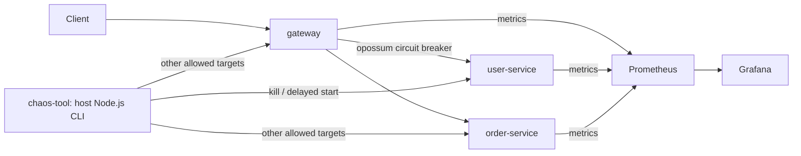

# Cerberus

A local chaos-engineering demo: kill a downstream service, observe the failure
in Prometheus/Grafana, and watch the gateway's circuit breaker recover.
The core project through Phase 5 has been verified with real container/API output.

## Architecture



Compose runs five containers on the shared `app` network. The chaos CLI runs
on the host and cannot target monitoring containers.

| Component | Implementation |
|---|---|
| gateway | Node.js HTTP server forwarding /users and /orders; opossum protects user-service |
| user-service | Node.js HTTP server returning in-memory sample users |
| order-service | Node.js HTTP server returning in-memory sample orders |
| prometheus | Official image; scrapes all three app services every 5 seconds |
| grafana | Official image; datasource/dashboard provisioned from repository files |
| chaos-tool | Node.js built-ins and Docker CLI; lists, kills an allowed target, restarts the same ID |

Each app has its own dependency manifest/Dockerfile and exposes `/health`
and `/metrics`. Request counts and latency histograms use `prom-client`.
The user-service circuit opens after **3 consecutive failed calls**, waits
**30 seconds**, and allows one Half-open probe. Success closes it; failure opens
it again. User-service failures/open-circuit rejections return HTTP 503 fallbacks.
Order-service calls have independent error handling.
Prometheus/Grafana data persists in named volumes; `observability/` contains
the scrape config and Grafana provisioning files.

## Run the project

Prerequisites: Docker Desktop with Linux containers (or Docker Engine), Docker
Compose, and Node.js 24 on the host for the chaos CLI. Run from the repo root.
No host npm install is needed; app dependencies install during Docker builds.

```powershell
docker compose up --build --detach
docker compose ps
curl.exe -i http://127.0.0.1:3000/users
curl.exe -i http://127.0.0.1:3000/orders
```

Allow image downloads and the first scrapes to finish.

| URL | Purpose |
|---|---|
| http://127.0.0.1:3000 | Gateway: /users, /orders, /health, /metrics |
| http://127.0.0.1:3001/health | Direct user-service health |
| http://127.0.0.1:3002/health | Direct order-service health |
| http://127.0.0.1:9090/targets | Prometheus targets |
| http://127.0.0.1:3003/d/cerberus-overview/cerberus-overview | Provisioned Grafana dashboard |

The dashboard opens with anonymous Viewer access and no manual setup/login.
It refreshes every 5 seconds and shows availability, request rate, HTTP 4xx/5xx
error rate, mean latency and the user-service circuit timeline.
Rate/latency panels exclude metrics scrapes and use a one-minute window.
They lag requests and can stay nonzero after traffic stops. Availability comes
from successful scrapes. Restarting an app resets its counters; rate charts need
fresh samples and traffic.

Stop the stack while retaining monitoring data with `docker compose down`.

## Run the chaos demo

Open the dashboard above and use two PowerShell terminals at the repo root.

### 1. Healthy baseline

In terminal B:

```powershell
1..8 | ForEach-Object {
  curl.exe -s http://127.0.0.1:3000/users
  curl.exe -s http://127.0.0.1:3000/orders
  Start-Sleep -Seconds 1
}
curl.exe -s http://127.0.0.1:9090/api/v1/targets
curl.exe -s http://127.0.0.1:3000/metrics | Select-String '^gateway_circuit_breaker_state'
```

Confirm all services are UP and the circuit Closed. If a prior run left it Open,
wait for cooldown and send a successful /users probe. Only the active state
metric is 1; other states are 0.

### 2. Trigger chaos

In terminal A:

```powershell
node chaos-tool/cli.js list
node chaos-tool/cli.js kill user-service --restart-after 60
```

Keep it running: it sends SIGKILL, logs the exited state, waits 60 seconds and
starts the same container automatically. It accepts service aliases or exact
container names. Only gateway/user-service/order-service are eligible; project
and directory labels are checked. Prometheus and Grafana are protected.
The default delay is 30 seconds; the configurable range is 0–86400 seconds.
See [CLI details](chaos-tool/README.md) for interruption/recovery behavior.

### 3. Trip and observe the breaker

As soon as terminal A reports `Stopped`, run in terminal B:

```powershell
1..3 | ForEach-Object { curl.exe -i http://127.0.0.1:3000/users }
curl.exe -i -w "\nElapsed seconds: %{time_total}\n" http://127.0.0.1:3000/users
curl.exe -i http://127.0.0.1:3000/orders
curl.exe -i http://127.0.0.1:3000/health
curl.exe -s http://127.0.0.1:3000/metrics | Select-String '^gateway_circuit_breaker_state'
```

The first failed calls return HTTP 503 after a failure/timeout; the third
consecutive failure opens the circuit. The next request returns a fast fallback:

```json
{"error":"User service temporarily unavailable","service":"user-service","circuit":"open"}
```

Allow a scrape/dashboard refresh. User-service becomes DOWN; gateway and
order-service stay UP. Gateway error rate rises and slow failed calls raise its
rolling mean latency. /orders and /health continue working.

Pause /users requests to reproduce the observed Half-open stage: 30 seconds
after opening, the circuit becomes Half-open and waits for a probe, even while
user-service is still down. A probe before recovery fails and starts another
30-second cooldown.

### 4. Automatic restart and recovery

Wait until terminal A reports `Restarted ... running=true`, then in terminal B:

```powershell
curl.exe -i http://127.0.0.1:3001/health
curl.exe -i http://127.0.0.1:3000/users
curl.exe -s http://127.0.0.1:3000/metrics | Select-String '^gateway_circuit_breaker_state'
curl.exe -s http://127.0.0.1:9090/api/v1/targets
docker compose logs --tail 15 gateway
```

A successful Half-open probe returns HTTP 200 with sample users and closes the
circuit. If still Open following an early failed probe, wait for the next
cooldown and retry. Subsequent scrapes/refreshes show user-service UP and the
timeline Closed. No stack/monitoring restart is needed.
Send more successful requests to show ongoing traffic; errors age out of the
rolling window.

## Observed end-to-end run — 2026-10-04

Checked Grafana's `POST /api/ds/query` with its actual provisioned panel
expressions, alongside Prometheus's `/api/v1/targets`, raw metrics and curl.
Dashboard circuit values are 0=Closed, 1=Open, 2=Half-open.

| Stage (UTC) | Real observations |
|---|---|
| 15:57:20 healthy | All app services UP; circuit Closed; gateway errors 0/sec; mean latency 4.79 ms |
| 15:57:21 chaos | CLI killed user-service: exited/137; restart scheduled in 60 seconds |
| 15:57:37 degraded | User-service DOWN, other apps UP; circuit Open; gateway errors 0.073/sec, mean latency 413 ms; user-service scrape timed out |
| 15:58:07 cooldown | User-service still DOWN; circuit Half-open waiting for a probe |
| 15:58:21 restart | CLI reported running=true; health and gateway recovery probe returned HTTP 200 |
| 15:58:29 recovered | All app services/targets UP; circuit Closed; gateway errors 0/sec; mean latency 6.15 ms |

The third failed call opened the circuit; the next fallback took **3.17 ms**.
Raw active state moved Closed → Open → Half-open → Closed.
Prometheus/Grafana container IDs and start times were unchanged throughout.
Exact chart values and timing vary with traffic and scrapes.

## Implementation ownership

Current implementation commits are recorded under Git author `swarupio`:
gateway/proxy/breaker, user-service, order-service, app metrics,
Prometheus/Grafana provisioning and the chaos CLI. Individual teammate
assignments are not recorded in PRD.md; this is Git attribution, not an
invented team split.

See [PRD.md](PRD.md) for scope and [WORKFLOW.md](WORKFLOW.md) for verified progress.
Cloud deployment remains an optional Phase 6 stretch goal.
